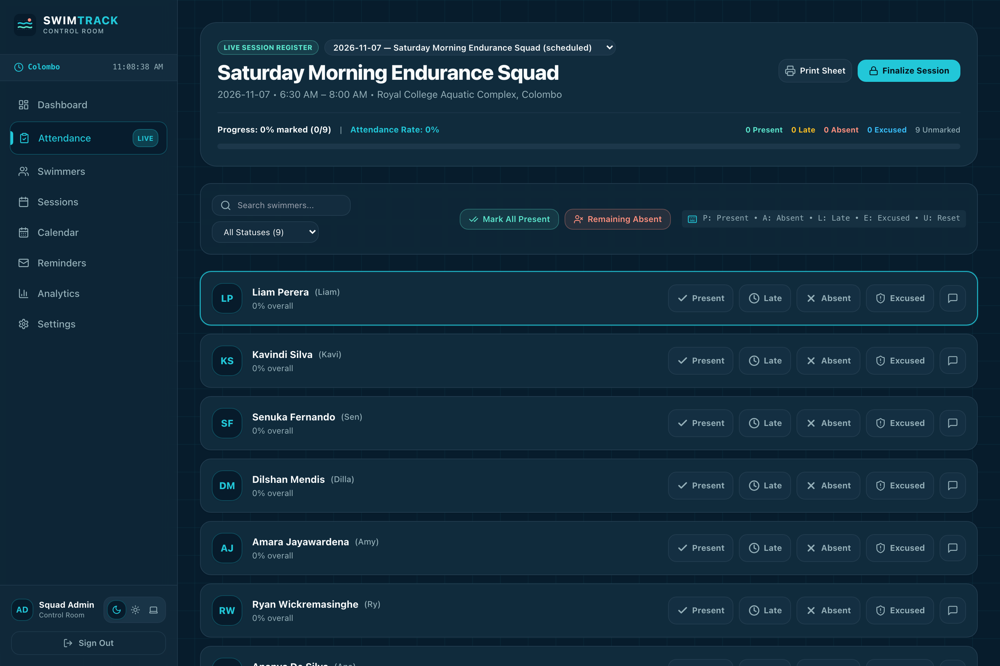
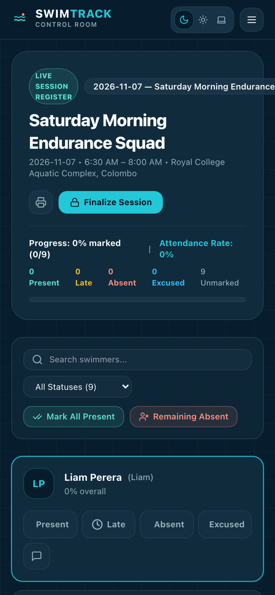
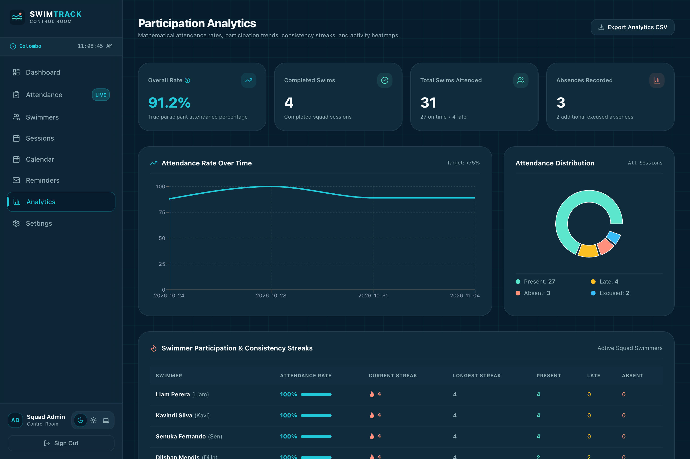
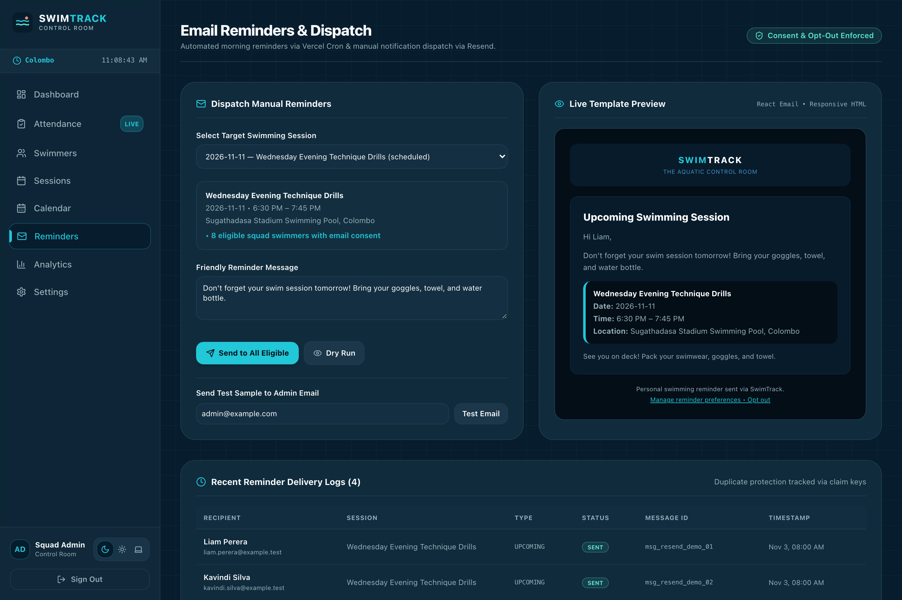
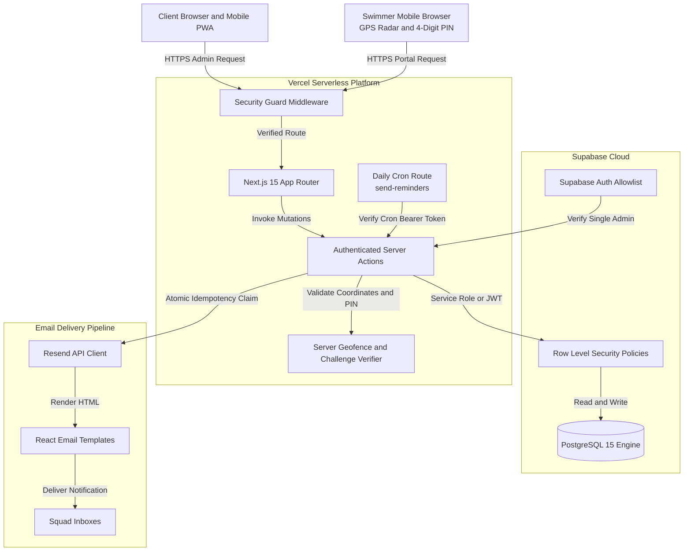
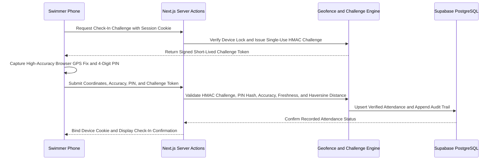
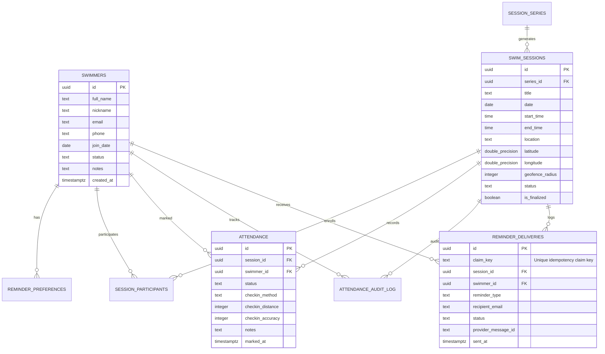

<div align="center">

# 🏊 SWIMTRACK

### A Weekend-Sport Passion Project Engineered Like a Production Aquatic Control Room

[](https://nextjs.org/)
[](https://react.dev/)
[](https://www.typescriptlang.org/)
[](https://tailwindcss.com/)
[](https://supabase.com/)
[](https://resend.com/)
[](LICENSE)

*Built for fun as a weekend hobby around our regular friend-group swim sessions — combining poolside banter, streaks, and friendly accountability with server-verified GPS geofencing, PIN-locked passes, and zero-friction attendance operations.*

[The Weekend Story](#-built-for-the-weekend-squad) • [Features](#-core-engineering-highlights) • [Screenshots](#-screenshots) • [Architecture](#-system-architecture) • [Database](#-database-schema) • [Quick Start](#-local-setup--execution) • [Testing](#-testing)

---

</div>

## 🌊 Built for the Weekend Squad

Every weekend sport crew knows the ritual: half the chat vows to hit the water on time, someone oversleeps, someone claims they were "right around the corner," and nobody remembers who actually held the longest streak last month.

**SwimTrack** started purely as a fun, non-commercial hobby project for our weekend swimming routine — an excuse to pair a favorite weekend sport with clean, opinionated software engineering. Beneath the playful squad personas and the **Polla Meter** (our lighthearted flakiness tracker), the system runs on serious full-stack foundations: server-side Haversine GPS geofencing, cryptographic single-use check-in challenges, device-bound 4-digit PIN passes, idempotent email pipelines, and strict PostgreSQL Row Level Security.

### Design Tenets
- **Crafted for Fun, Built to Last**: Zero SaaS subscriptions, paywalls, or commercial bloat — purely built for recreational squads, friends, and the joy of shipping real tools.
- **Zero-Friction Swimmer Experience**: Squad members join via a shareable link, unlock their personal pass with a 4-digit PIN, RSVP in one tap, and verify attendance right on the pool deck.
- **Honest Poolside Verification**: Check-ins validate real GPS coordinates against the pinned venue radius (`75m` default), reject stale or coarse readings, and lock one device per session to stop buddy-punching.
- **Privacy by Architecture**: Personal emails, pool coordinates, and squad rosters stay strictly in private environment variables and Supabase — never hardcoded in source control.
- **Free-Tier Serverless Footprint**: Runs smoothly on Vercel Hobby, Supabase PostgreSQL, and Resend with zero dedicated servers to babysit.

---

## ✨ Core Engineering Highlights

### 📍 Poolside GPS Radar & Anti-Cheat Check-In
- **Server-Side Haversine Geofencing**: Validates swimmer coordinates against the session's pinned pool center (`25m–250m`, default `75m`) entirely on the server.
- **Multi-Layer Anti-Cheat Pipeline**:
  - Single-use HMAC-signed check-in challenges prevent replay attacks.
  - Coarse GPS readings (`>50m` accuracy) and stale fixes (`>90s` old) are rejected.
  - Device-binding cookies block buddy-punching (one phone cannot check in two swimmers for the same session).
  - Server-clock time windows (`Asia/Colombo`) determine on-time vs. late arrivals regardless of device clock tampering.
- **Interactive Map Pool Pin Picker**: Leaflet + OpenStreetMap picker with place search, draggable pool marker, reverse geocoding, and adjustable geofence rings. Custom private pool presets load cleanly via `NEXT_PUBLIC_PRESET_VENUES`.

### 🎫 Passwordless Swimmer Pass Portal (`/portal`)
- **Personal 4-Digit PIN & Token Pass**: Salted SHA-256 PIN verification with rate limiting and `HttpOnly` session cookies — no password fatigue.
- **1-Tap RSVP & Squad Chalkboard**: Upcoming practice confirmation, pre-session excused absence declarations (with coach-configurable cutoff window and reason categories), and live squad notes.
- **Friends Squad Analytics Leaderboard**: Personal turnout rates, streaks, and live **Squad Persona & Polla Meter** rankings.

### ⚡ Admin Aquatic Control Room
- **High-Speed Attendance Register**: Five distinct states (`Present`, `Late`, `Absent`, `Excused`, `Not Marked`), desktop keyboard shortcuts (`P`, `A`, `L`, `E`, `U`), bulk actions with confetti, optimistic UI with rollback, and full audit logging.
- **Session Lifecycle & Recurrence**: Single and recurring weekly series generators, per-session pool pin overrides, finalize/reopen locks, `.ics` calendar export, and safe cascade deletion with confirmation.
- **Automated Email Reminder Engine**: Seven responsive React Email templates (Upcoming Session with Pool Radar CTA, Session Today, Session Changed, Session Cancelled, Welcome Pack, Swimmer Pass Setup Guide, and Admin Registration Alert) dispatched via Resend with atomic claim keys, idempotency headers, consent checks, one-click opt-out, and daily Vercel Cron (`30 2 * * *` UTC).
- **Mathematical Turnout Analytics**: Exact rate calculation `((Present + Late) / (Present + Late + Absent)) × 100` excluding `Excused`, `Not Marked`, and cancelled sessions from the denominator, paired with chronological streak calculations and Recharts visualizations.

---

## 📸 Screenshots

All screenshots below capture the running application populated exclusively with fictional demonstration data.

### Dashboard & Upcoming Session Hero


### Attendance Command Center
*Built for rapid poolside recording with desktop keyboard shortcuts (`P`, `A`, `L`, `E`, `U`), touch-friendly controls, and instant optimistic updates.*


### Mobile Pool-Deck Register
*Ergonomic mobile navigation and tap targets tuned for sub-10-second deck check-ins.*
<div align="center">
  
</div>

### Participation Analytics & Streaks
*Turnout trends, attendance distribution breakdowns, and chronological streak tracking.*


### Swimmers Roster & Profiles


### Session Calendar & Agenda


### Email Reminders & Live Preview
*Powered by Resend and React Email with atomic claim keys, dry runs, and delivery logs.*


---

## 🏛️ System Architecture



### Poolside Geofence Check-In Sequence



### Dual-Engine Execution
1. **Standalone Local Demo Mode**: Boots immediately after `npm install && npm run dev` with zero external API keys required, powered by an in-memory data store seeded with fictional demo swimmers and pools.
2. **Production Supabase Mode**: Automatically switches to live PostgreSQL persistence with Row Level Security once Supabase environment variables are present in `.env.local`.

---

## 🗄️ Database Schema



---

## 📂 Repository Structure

```text
SwimTrack/
├── docs/                           # Architecture, database, deployment, user guide, and demo screenshots
├── e2e/                            # Playwright end-to-end tests (desktop & mobile viewports)
├── scripts/                        # Demo database seeder and screenshot automation
├── supabase/
│   ├── migrations/                 # PostgreSQL schema, RLS policies, and geofence hardening SQL
│   └── seed.sql                    # Fictional demonstration dataset
├── src/
│   ├── actions/                    # Server Actions (attendance, auth, portal, reminders, sessions, settings, swimmers)
│   ├── app/
│   │   ├── (admin)/                # Protected Admin Control Room routes (dashboard, attendance, swimmers, sessions, calendar, reminders, analytics, settings)
│   │   ├── api/cron/send-reminders/# Bearer-protected daily Vercel Cron handler
│   │   ├── join/                   # Frictionless self-registration invite portal
│   │   ├── login/                  # Single-admin authentication screen
│   │   ├── portal/                 # Passwordless PIN-locked Swimmer Pass & Poolside GPS Radar
│   │   └── reminders/opt-out/      # Tokenized self-service email opt-out page
│   ├── components/                 # Modular UI components (attendance, analytics, calendar, portal, reminders, sessions, settings, swimmers)
│   ├── emails/                     # 7 responsive React Email templates
│   ├── lib/                        # Core engines (geo-fence, checkin-challenge, attendance-calculator, squad-ranks, resend-service, security, rate-limiter, data-store, supabase-db)
│   ├── types/                      # Strict TypeScript domain models
│   └── middleware.ts               # Route protection & security headers
├── .env.example                    # Complete environment configuration template
├── vercel.json                     # Daily morning reminder Cron schedule
└── package.json                    # Scripts, metadata, and dependencies
```

---

## 🚀 Local Setup & Execution

### Prerequisites
- **Node.js 20+** and **npm**
- Optional for live production mode: a free [Supabase](https://supabase.com) project and a [Resend](https://resend.com) API key.

### 1. Clone & Install
```bash
git clone https://github.com/theekshana-sudeepa/SwimTrack.git
cd SwimTrack
npm install
```

### 2. Configure Environment Variables
Copy the safe template and customize your local values:
```bash
cp .env.example .env.local
```

> **Tip for keeping your real pool private:** Pass your personal weekend pool coordinates via `NEXT_PUBLIC_PRESET_VENUES` in `.env.local` (or Vercel Environment Variables) rather than editing source files.

### 3. Run Locally
```bash
npm run dev
```
Open [http://localhost:3000](http://localhost:3000). Without Supabase keys configured, SwimTrack automatically runs in standalone demo mode using fictional swimmers and demonstration pools.

### 4. Initialize Supabase (Production Mode)
Run the SQL files in `supabase/migrations/` in chronological order via the Supabase SQL Editor:
1. `20260101000000_swimtrack_schema.sql`
2. `20260102000000_add_geofence_attendance.sql`
3. `20260103000000_geofence_hardening.sql`

*(Optional)* Load fictional sample records with `supabase/seed.sql` or set `START_FRESH="true"` for a clean production roster.

---

## ⚙️ Environment Variables

| Variable | Description | Example / Default |
| --- | --- | --- |
| `NEXT_PUBLIC_APP_URL` | Base application URL for links and callbacks | `http://localhost:3000` |
| `NEXT_PUBLIC_TIMEZONE` | Squad local timezone | `Asia/Colombo` |
| `NEXT_PUBLIC_PRESET_VENUES` | Optional JSON array of private preset pool venues & coordinates | `[{"key":"home","name":"My Pool",...}]` |
| `NEXT_PUBLIC_SUPABASE_URL` | Supabase project URL | `https://your-project-id.supabase.co` |
| `NEXT_PUBLIC_SUPABASE_ANON_KEY` | Supabase public anon key | `eyJhbGciOi...` |
| `SUPABASE_SERVICE_ROLE_KEY` | Server-only Supabase service role key | `eyJhbGciOi...` |
| `ADMIN_EMAIL` | Single allowlisted administrator email | `admin@example.com` |
| `ADMIN_PASSWORD` | Master administrator password | `strong-secret-password` |
| `ADMIN_USER_ID` | Allowlisted Supabase Auth UID | `00000000-0000-0000-0000-000000000000` |
| `SWIMMER_PIN_SALT` | High-entropy cryptographic salt for 4-digit PIN hashing | `openssl rand -base64 32` |
| `CHECKIN_CHALLENGE_SECRET` | HMAC secret for single-use GPS check-in challenge tokens | `openssl rand -base64 32` |
| `RESEND_API_KEY` | Resend transactional email API key | `re_123456789...` |
| `RESEND_FROM_EMAIL` | Verified Resend sender identity | `SwimTrack <onboarding@resend.dev>` |
| `CRON_SECRET` | Bearer secret protecting `/api/cron/send-reminders` | `openssl rand -base64 32` |
| `START_FRESH` | Boot with an empty slate instead of demo fixtures | `true` |

---

## 🧪 Testing

```bash
# ESLint validation
npm run lint

# TypeScript strict typecheck
npm run typecheck

# Vitest unit & integration test suite (80+ tests)
npm run test

# Playwright E2E browser tests (Desktop & Mobile viewports)
npm run test:e2e

# Production build verification
npm run build
```

---

## 🔒 Security & Privacy

- **Strict Single-Admin Control**: All administrative routes and Server Actions verify signed `HttpOnly` session cookies and environment-allowlisted admin credentials.
- **Database Hardening**: PostgreSQL Row Level Security policies and check constraints enforce valid geofence radii (`25m–250m`), provenance badges (`coach_manual`, `geofence_self`, `bulk`), and unique `(session_id, swimmer_id)` records.
- **Zero Personal Data in Source**: No real swimmer rosters, personal email addresses, private deployment URLs, or personal pool coordinates are committed to version control.
- **Rate Limiting & Replay Defense**: PIN verification, challenge issuance, excuse submissions, and check-ins are rate-limited and protected with timing-safe cryptographic checks.

---

## 📄 License

SwimTrack is licensed under the **[PolyForm Noncommercial License 1.0.0](LICENSE)**.

- **Permitted**: Study, fork, modify, and self-host SwimTrack freely for personal, non-commercial swimming crews, weekend friend groups, amateur recreational squads, and educational use.
- **Prohibited**: Commercial resale, paid SaaS hosting, commercial gym/club deployments, or charging fees for attendance tracking and notifications.

---

<div align="center">

Built with curiosity and weekend pool momentum by **Theekshana Sudeepa**

[LinkedIn](https://www.linkedin.com/in/theekshana-sudeepa/) · [GitHub](https://github.com/theekshana-sudeepa) · [LexoraTech](https://lexoratech.com)

</div>
