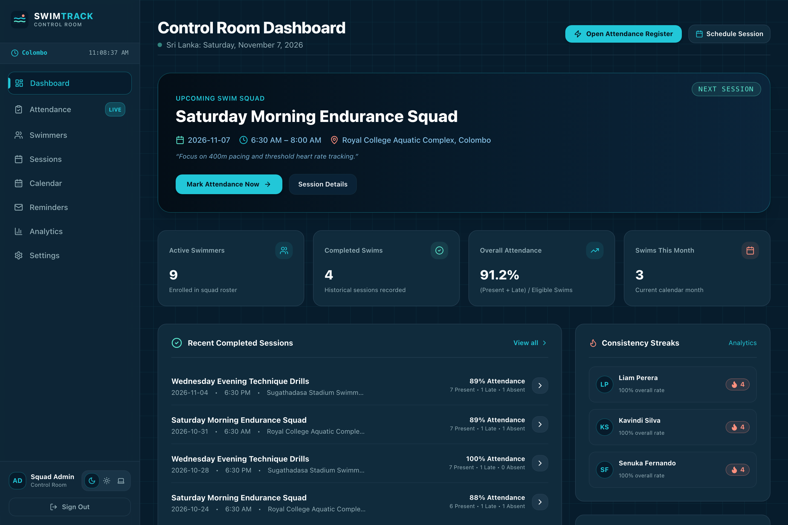
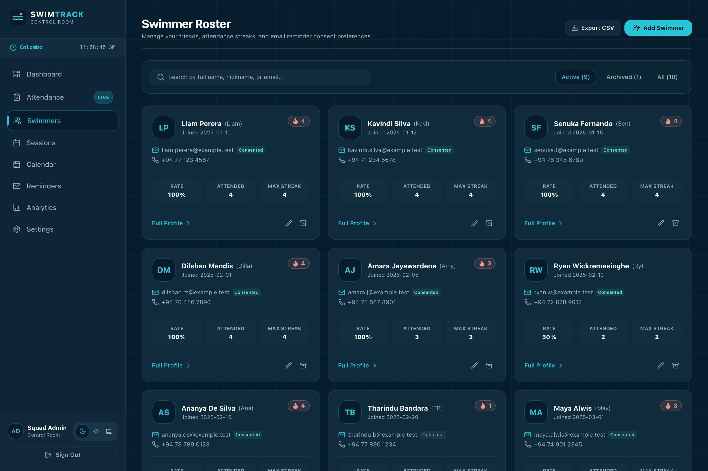
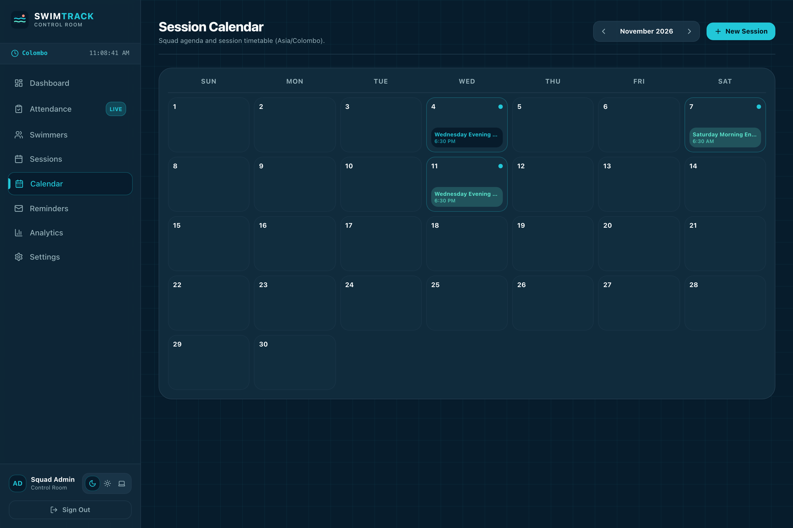
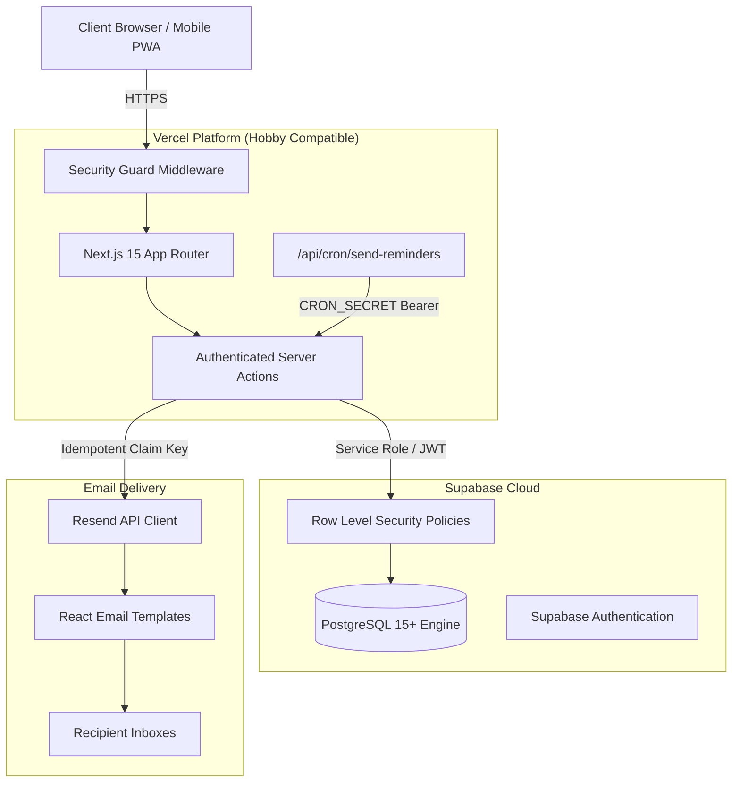
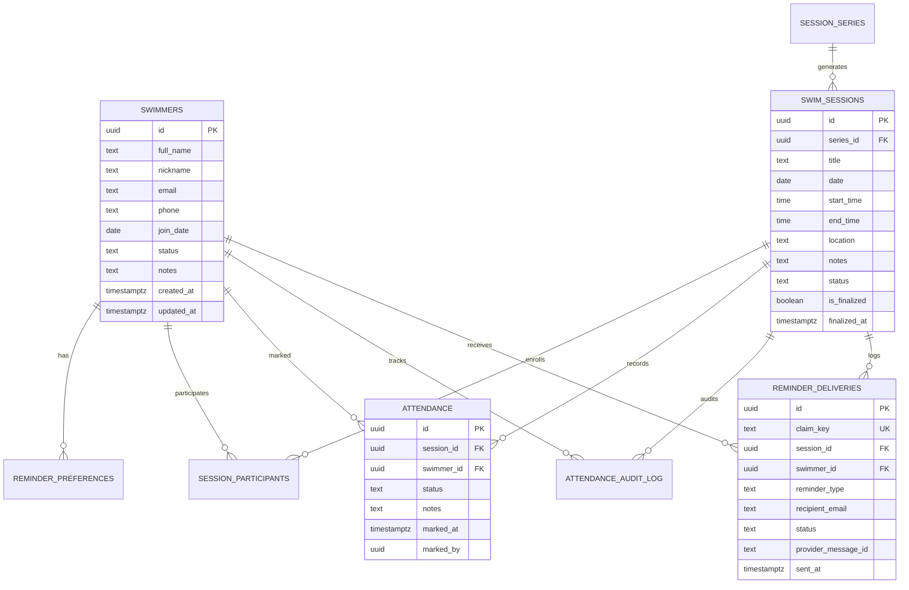

<div align="center">

# 🏊 SWIMTRACK

### The Aquatic Control Room — Premium Open-Source Swimming Attendance Platform

[](https://nextjs.org/)
[](https://react.dev/)
[](https://www.typescriptlang.org/)
[](https://tailwindcss.com/)
[](https://supabase.com/)
[](https://resend.com/)
[](LICENSE)

*A personal, non-commercial web platform designed for recording squad swimming attendance, managing recurring pool practices, dispatching friendly email reminders, and visualizing participation streaks.*

[Features](#-key-features) • [Screenshots](#-screenshots) • [Architecture](#-architecture) • [Quick Start](#-quick-start) • [Deployment](#-deployment) • [Database](#-database-schema) • [Testing](#-testing)

---

</div>

## 🌊 Overview

**SwimTrack** is an open-source web application created for coordinating friendly swimming squad sessions without generic spreadsheet clutter or bloated SaaS memberships.

### Product Philosophy
- **Single Administrator**: Built specifically for one designated administrator.
- **Zero Account Friction**: Friends do not require accounts, passwords, or logins to attend practices.
- **100% Non-Commercial**: No payments, subscriptions, memberships, checkout pages, or financial tracking.
- **Vercel Hobby Friendly**: Powered entirely by free-tier friendly serverless infrastructure (Next.js App Router, Supabase PostgreSQL, Resend Email API, and Vercel Cron).

---

## 📸 Screenshots

All screenshots below represent the real application running with fictional demonstration data.

### Dashboard & Upcoming Session Hero


### Attendance Command Center (Most Important Feature)
*Optimized for rapid pool deck recording with desktop keyboard shortcuts (`P`, `A`, `L`, `E`, `U`), touch-friendly controls, and instant optimistic updates.*


### Mobile Pool-Deck Attendance
*Ergonomic mobile bottom navigation bar and touch targets designed for fast recording under 10 seconds.*
<div align="center">
  
</div>

### Participation Analytics & Streaks
*Mathematically rigorous attendance calculations, trend charts, distribution breakdowns, and streaks.*


### Swimmers Roster & Profiles


### Session Calendar & Agenda


### Email Reminders & Live Preview
*Powered by Resend and React Email with atomic claim keys and duplicate prevention.*


---

## ✨ Key Features

- **Attendance Command Center**:
  - Five distinct states: `Present`, `Late`, `Absent`, `Excused`, and `Not Marked`.
  - Not Marked is strictly distinguished from Absent.
  - Desktop keyboard shortcuts (`P` = Present, `A` = Absent, `L` = Late, `E` = Excused, `U` = Reset).
  - Bulk actions: `Mark All Present` with confetti, `Mark Remaining Absent` with confirmation.
  - Real-time optimistic UI with automatic rollback on network failure.
  - Private attendance audit log tracking every status change and timestamp.
  - Finalize / Reopen session workflow with warnings for unmarked participants.

- **Swimmer & Roster Management**:
  - Roster tracking with optional nicknames, emails, and phone numbers.
  - Email addresses are strictly optional; friends can participate without receiving emails.
  - Individual swimmer profiles with initials avatars, consistency streaks, and milestone badges.
  - CSV export for roster and attendance records.

- **Session Scheduling & Recurrence**:
  - Single session scheduler and recurring weekly practice series generator.
  - Asia/Colombo (UTC+05:30) timezone consistency.
  - Snapshot participant lists per session to protect historical attendance records when swimmers are added or archived.
  - One-click `.ics` calendar file downloads.

- **Email Reminder Engine**:
  - Four custom React Email templates: Upcoming Session, Session Today, Session Changed, and Session Cancelled.
  - Recipient consent enforcement: Only swimmers with `email_reminders_enabled: true` receive emails.
  - One-click self-service opt-out link in every email.
  - Duplicate protection with atomic claim keys (`${sessionId}:${swimmerId}:${type}:${date}`) and Resend idempotency headers.
  - Daily Vercel Cron trigger at ~8:00 AM Asia/Colombo (02:30 UTC).
  - Live preview, manual dispatch, test send, and delivery log viewer.

- **Mathematical Analytics**:
  - Exact formula: `Attendance Rate = (Present + Late) / (Present + Late + Absent) × 100`.
  - Excludes Excused absences, Not Marked entries, and Cancelled sessions from the denominator.
  - Attendance trend line charts and participation distribution pie charts using Recharts.
  - Current and longest consistency streaks calculated chronologically.

---

## 🏛️ Architecture



### Dual-Engine Data Store
SwimTrack supports **Dual-Engine Execution**:
1. **Local Standalone Demo Mode**: Runs instantly out of the box when cloning the repository with zero external keys required. A durable in-memory state initialized with fictional data allows full interaction (marking attendance, adding swimmers, scheduling sessions, running tests).
2. **Production Supabase Mode**: Automatically switches to live PostgreSQL with Row Level Security once `.env.local` contains Supabase credentials.

---

## 🗄️ Database Schema



---

## 🚀 Quick Start

### 1. Clone & Install
```bash
git clone https://github.com/your-username/SwimTrack.git
cd SwimTrack
npm install
```

### 2. Run in Standalone Demo Mode
```bash
npm run dev
```
Open [http://localhost:3000](http://localhost:3000) in your browser.
Click **Admin Portal** and use the **Instant Demo Admin Sign In** button to evaluate the complete control room with rich demo data!

### 3. Configure Production Environment (Optional)
Copy `.env.example` to `.env.local`:
```bash
cp .env.example .env.local
```

Fill in your Supabase, Resend, and Admin credentials.

---

## ⚙️ Environment Variables

| Variable | Description | Example / Default |
| --- | --- | --- |
| `NEXT_PUBLIC_APP_URL` | Base application URL | `http://localhost:3000` |
| `NEXT_PUBLIC_TIMEZONE` | Squad local timezone | `Asia/Colombo` |
| `NEXT_PUBLIC_SUPABASE_URL` | Supabase project URL | `https://xyz.supabase.co` |
| `NEXT_PUBLIC_SUPABASE_ANON_KEY` | Public Supabase anon key | `eyJhbGciOi...` |
| `SUPABASE_SERVICE_ROLE_KEY` | Server-only service key | `eyJhbGciOi...` |
| `ADMIN_EMAIL` | Single allowlisted administrator email | `admin@example.com` |
| `ADMIN_USER_ID` | Single allowlisted Supabase Auth UID | `uuid-string` |
| `RESEND_API_KEY` | Resend transactional email API key | `re_123...` |
| `RESEND_FROM_EMAIL` | Verified sending address | `SwimTrack <notifications@yourdomain.com>` |
| `CRON_SECRET` | Bearer secret protecting `/api/cron/send-reminders` | `high-entropy-random-string` |

---

## 🧪 Testing

SwimTrack includes a comprehensive automated test suite across unit, mathematical, and browser levels:

```bash
# Run ESLint validation
npm run lint

# Run TypeScript strict typecheck
npm run typecheck

# Run Vitest unit & integration tests
npm run test

# Run Playwright E2E browser tests (Desktop & Mobile viewports)
npm run test:e2e

# Run Next.js production build verification
npm run build
```

---

## 🚢 Deployment to Vercel

1. Push your repository to GitHub.
2. Import project in [Vercel](https://vercel.com).
3. Add the environment variables listed in `.env.example`.
4. Deploy! Vercel automatically registers the daily cron job specified in `vercel.json`:
   ```json
   {
     "crons": [
       {
         "path": "/api/cron/send-reminders",
         "schedule": "30 2 * * *"
       }
     ]
   }
   ```
   *(02:30 UTC fires at approximately 8:00 AM in Sri Lanka).*

---

## 🔒 Security

- **Strict Single-Admin Model**: Only one allowlisted administrator can authenticate and invoke server actions.
- **RLS Enforced**: PostgreSQL tables enforce Row Level Security.
- **Private Data Protection**: Real swimmer names and emails are never exposed on public landing pages or committed to version control.
- **Safe Environment Handling**: Secrets and service-role keys are never exposed in browser bundles.

---

## 📄 License

This project is licensed under the [MIT License](LICENSE).

