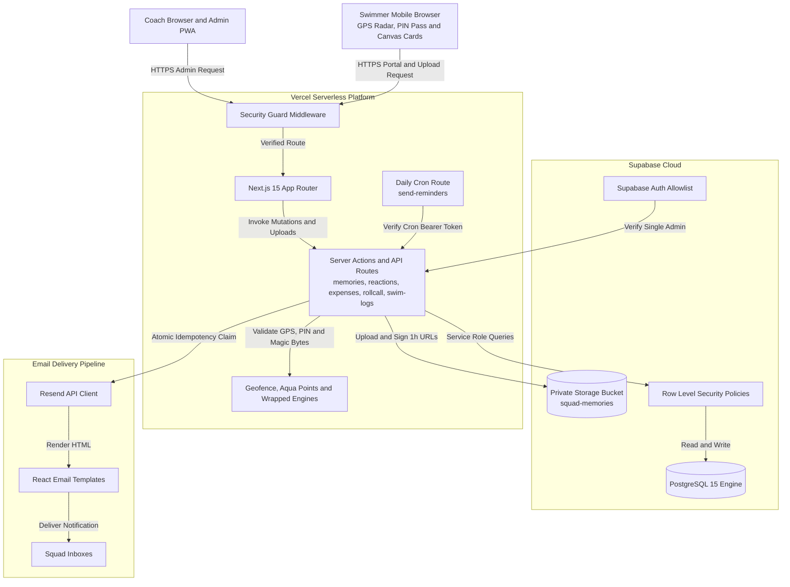
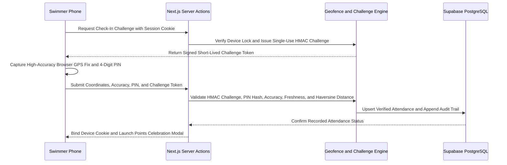
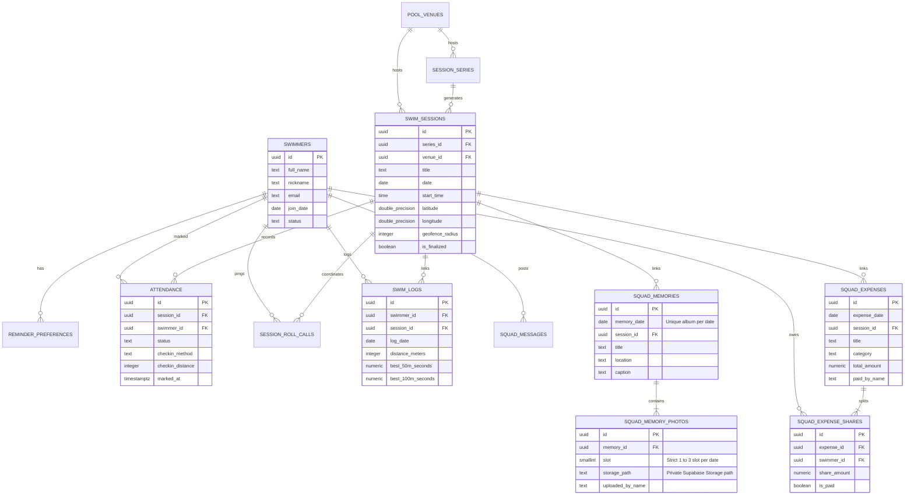

<div align="center">

# 🏊 SWIMTRACK

### A Weekend-Sport Passion Project Engineered Like a Production Aquatic Control Room

[](https://nextjs.org/)
[](https://react.dev/)
[](https://www.typescriptlang.org/)
[](https://tailwindcss.com/)
[](https://supabase.com/)
[](https://resend.com/)
[](LICENSE)

*Built for fun as a weekend hobby around our regular friend-group swim sessions — combining poolside banter, Aqua Points rankings, private squad memories, bill splits, and swim PRs with server-verified GPS geofencing, PIN-locked passes, and zero-friction attendance operations.*

[The Weekend Story](#-built-for-the-weekend-squad) • [Features](#-core-engineering-highlights) • [Screenshots](#-screenshots) • [Architecture](#-system-architecture) • [Database](#-database-schema) • [Quick Start](#-local-setup--execution) • [Testing](#-testing)

---

</div>

## 🌊 Built for the Weekend Squad

Every weekend sport crew knows the ritual: half the chat vows to hit the water on time, someone oversleeps, someone claims they were "right around the corner," nobody remembers who paid for pool tickets and coffee, and group photos disappear inside endless chat threads.

**SwimTrack** started purely as a fun, non-commercial hobby project for our weekend swimming routine — an excuse to pair a favorite weekend sport with clean, opinionated full-stack engineering. Beneath the playful squad personas, **Aqua Points Power Rankings**, and the **Polla Meter** (our lighthearted flakiness tracker), the system runs on serious production foundations: server-side Haversine GPS geofencing, cryptographic single-use check-in challenges, device-bound 4-digit PIN passes, private Supabase Storage with short-lived signed URLs, idempotent email pipelines, and strict PostgreSQL Row Level Security.

### Design Tenets
- **Crafted for Fun, Built to Last**: Zero SaaS subscriptions, paywalls, or commercial bloat — built purely for recreational squads, friends, and the joy of shipping real tools.
- **Zero-Friction Swimmer Experience**: Squad members join via a shareable link, unlock their personal pass with a 4-digit PIN, ping pre-swim roll-call, check in on the pool deck, split post-swim coffee bills, and relive weekend photo memories in one place.
- **Honest Poolside Verification**: Check-ins validate real GPS coordinates against the pinned venue radius (`25m–250m`, default `75m`), reject stale or coarse readings, and lock one device per session to stop buddy-punching.
- **Privacy by Architecture**: Personal emails, pool coordinates, squad rosters, and personal squad photos stay strictly in private environment variables, Supabase Postgres, and private Supabase Storage buckets — never committed to source control.
- **Free-Tier Serverless Footprint**: Runs smoothly on Vercel Hobby, Supabase PostgreSQL + Storage, and Resend with zero dedicated servers to babysit.

---

## ✨ Core Engineering Highlights

### 📍 Poolside GPS Radar, Saved Venues & Anti-Cheat Check-In
- **Server-Side Haversine Geofencing**: Validates swimmer coordinates against the session's pinned pool center (`25m–250m`, default `75m`) entirely on the server.
- **Multi-Layer Anti-Cheat Pipeline**:
  - Single-use HMAC-signed check-in challenges prevent replay attacks.
  - Coarse GPS readings (`>50m` accuracy) and stale fixes (`>90s` old) are rejected.
  - Device-binding cookies block buddy-punching (one phone cannot check in two swimmers for the same session).
  - Server-clock time windows (`Asia/Colombo`) determine on-time vs. late arrivals regardless of device clock tampering.
- **Saved Swimming Places & Map Pin Picker**: Manage custom pool venues (`pool_venues`) with Leaflet + OpenStreetMap search, draggable pins, Google Maps coordinate/link paste, adjustable geofence rings, and default venue sync across recurring series.

### 🏆 Aqua Points Power Rankings & Check-In Ceremony
- **Transparent Points Engine**: Scores on-time check-ins, late arrival minute decay, streak bonuses, GPS verification bonuses, excused protection, and Polla penalties with **true shared competition ties (`=1`)** and exclusive **Squad Crowns**.
- **Live Poolside Celebration**: Animated check-in modal with points odometer, confetti, and overtake callouts, paired with **Since-Last-Visit Rank Shift Alerts**, a **Next-Target Chase Meter**, and tap-to-inspect **Session Points Receipts**.

### 📸 Private End-of-Day Squad Memories Vault (`/memories` & Portal)
- **Date-First 1–3 Photo Rule**: Enforced directly in PostgreSQL (`CHECK (slot BETWEEN 1 AND 3)` + unique `(memory_id, slot)`), letting both Coach and PIN-verified swimmers contribute up to 3 memories per date.
- **Private Storage + Smart Compression**: Client-side `<canvas>` WebP/JPEG resizing (~200–400 KB), server-side image magic-byte validation, private `squad-memories` Supabase Storage bucket, and batched 1-hour Signed URLs.
- **Magazine Collages, Auto-Attendees & Shareable Polaroids**: Adaptive 1 / 2 / 3-photo bento layouts, full-screen lightbox with save/download, auto-tagged **"Who Swam That Day"** roster badges, clickable `📸` links inside Attendance History, and 1-tap **1080×1350 Polaroid Memory Cards** for WhatsApp and Stories.

### 💬 Persistent Chalkboard, Emoji Reactions & Squad Kitty Bill Splits (`/splits`)
- **Persistent Squad Chalkboard & Reactions**: Postgres-backed squad wall (`squad_messages`) with 1-tap toggleable emoji reactions (`🔥 😂 ❤️ 🏊 ☕`) on both Chalkboard posts and Squad Memory albums.
- **After-Swim Bill & Pool Ticket Splits**: Log pool entry fees, cafe runs, or transport bills in `LKR` with zero-drift cent-accurate even splits or custom overrides, 1-tap **"Today's Swimmers"** auto-selection, personal portal balance summaries (*Pending To Pay* vs. *Friends Owe You*), and payer/coach **Paid ✅ / Pending ⏳** toggles.

### 🚗 Pre-Swim Live Roll-Call, Swim PRs & Monthly Squad Wrapped
- **Pre-Swim Roll-Call & Ride Coordination**: 1-tap morning status pings (**Awake**, **On My Way**, **Offering Ride**, **Need a Ride**, **Running Late**) with optional pickup/ETA notes right inside the Next Practice card.
- **Personal Swim Distance Challenge & PRs**: 3-second lap/meter logger (`25m` / `50m` pools), fastest `50m` & `100m` PR tracker, squad distance leaderboard, and Sri Lankan **Squad Distance Milestones** (*Mount Lavinia Reef → Palk Strait → Galle Fort → Halfway Around Sri Lanka*).
- **Monthly & All-Time Squad Wrapped**: 4-slide interactive recap modal (accessible from both the Swimmer Portal and Admin Analytics) highlighting real GPS **Earliest Bird on Deck**, **#1 Pool Boss**, **Distance Machine**, **Polla King**, personal month spotlight, and a 1-tap **1080×1350 Shareable Wrapped PNG**.

### ⚡ Admin Aquatic Control Room
- **High-Speed Attendance Register**: Five distinct states (`Present`, `Late`, `Absent`, `Excused`, `Not Marked`), desktop keyboard shortcuts (`P`, `A`, `L`, `E`, `U`), bulk actions with confetti, optimistic UI with rollback, and full audit logging.
- **Session Lifecycle & Recurrence**: Single and recurring weekly series generators, per-session pool pin overrides, finalize/reopen locks, `.ics` calendar export, quick session photo uploads, and safe cascade deletion.
- **Automated Email Reminder Engine**: Seven responsive React Email templates dispatched via Resend with atomic claim keys, idempotency headers, consent checks, one-click opt-out, and daily Vercel Cron (`30 2 * * *` UTC).
- **Mathematical Turnout Analytics**: Exact rate calculation `((Present + Late) / (Present + Late + Absent)) × 100` excluding `Excused`, `Not Marked`, and cancelled sessions, paired with chronological streaks and Recharts visualizations.

---

## 📸 Screenshots

All screenshots below capture the running application populated exclusively with fictional demonstration data.

### Dashboard & Upcoming Session Hero


### Attendance Command Center
*Built for rapid poolside recording with desktop keyboard shortcuts (`P`, `A`, `L`, `E`, `U`), touch-friendly controls, and instant optimistic updates.*


### Mobile Pool-Deck Register
*Ergonomic mobile navigation and tap targets tuned for sub-10-second deck check-ins.*
<div align="center">
  
</div>

### Participation Analytics & Streaks
*Turnout trends, attendance distribution breakdowns, chronological streaks, and Monthly Squad Wrapped.*


### Swimmers Roster & Profiles


### Session Calendar & Agenda


### Email Reminders & Live Preview
*Powered by Resend and React Email with atomic claim keys, dry runs, and delivery logs.*


---

## 🏛️ System Architecture



### Poolside Geofence Check-In Sequence



### Dual-Engine Execution
1. **Standalone Local Demo Mode**: Boots immediately after `npm install && npm run dev` with zero external API keys required, powered by an in-memory data store seeded with fictional demo swimmers and pools.
2. **Production Supabase Mode**: Automatically switches to live PostgreSQL + Private Storage persistence with Row Level Security once Supabase environment variables are present in `.env.local`.

---

## 🗄️ Database Schema



---

## 📂 Repository Structure

```text
SwimTrack/
├── docs/                           # Architecture, database, deployment, user guide, and demo screenshots
├── e2e/                            # Playwright end-to-end tests (desktop & mobile viewports)
├── scripts/                        # Demo database seeder and screenshot automation
├── supabase/
│   ├── migrations/                 # 7 ordered PostgreSQL & Storage migrations (schema, geofence, venues, memories, social/splits, roll-call/logs)
│   └── seed.sql                    # Fictional demonstration dataset
├── src/
│   ├── actions/                    # Server Actions (attendance, auth, portal, reminders, sessions, settings, swimmers, venues)
│   ├── app/
│   │   ├── (admin)/                # Protected Admin Control Room (dashboard, attendance, swimmers, sessions, calendar, memories, splits, reminders, analytics, settings)
│   │   ├── api/
│   │   │   ├── cron/send-reminders/# Bearer-protected daily Vercel Cron handler
│   │   │   ├── memories/           # Private photo upload, metadata, delete & authenticated download proxy
│   │   │   ├── reactions/          # Toggleable emoji reactions on memories & chalkboard
│   │   │   ├── expenses/           # After-swim LKR bill splits & payment status toggles
│   │   │   ├── rollcall/           # Pre-swim live roll-call & ride pings
│   │   │   └── swim-logs/          # Personal swim distance & PR logs
│   │   ├── join/                   # Frictionless self-registration invite portal
│   │   ├── login/                  # Single-admin authentication screen
│   │   ├── portal/                 # PIN-locked Swimmer Pass (Radar, Memories, Splits, Roll-Call, Swim PRs, Wrapped)
│   │   └── reminders/opt-out/      # Tokenized self-service email opt-out page
│   ├── components/                 # Modular UI (analytics, attendance, calendar, memories, portal, reminders, sessions, settings, social, splits, swimmers, wrapped)
│   ├── emails/                     # 7 responsive React Email templates
│   ├── lib/                        # Core engines (geo-fence, checkin-challenge, squad-ranks, squad-wrapped, memories-service, social-service, expenses-service, rollcall-service, swim-logs-service, polaroid-generator, wrapped-card-generator, image-compress, data-store, supabase-db)
│   ├── types/                      # Strict TypeScript domain models
│   └── middleware.ts               # Route protection & security headers
├── .env.example                    # Complete environment configuration template
├── vercel.json                     # Daily morning reminder Cron schedule
└── package.json                    # Scripts, metadata, and dependencies
```

---

## 🚀 Local Setup & Execution

### Prerequisites
- **Node.js 20+** and **npm**
- Optional for live production mode: a free [Supabase](https://supabase.com) project and a [Resend](https://resend.com) API key.

### 1. Clone & Install
```bash
git clone https://github.com/theekshana-sudeepa/SwimTrack.git
cd SwimTrack
npm install
```

### 2. Configure Environment Variables
Copy the safe template and customize your local values:
```bash
cp .env.example .env.local
```

> **Tip for keeping your real pool private:** Pass your personal weekend pool coordinates via `NEXT_PUBLIC_PRESET_VENUES` in `.env.local` (or manage them inside **Settings → Swimming Places**) rather than editing source files.

### 3. Run Locally
```bash
npm run dev
```
Open [http://localhost:3000](http://localhost:3000). Without Supabase keys configured, SwimTrack automatically runs in standalone demo mode using fictional swimmers and demonstration pools.

### 4. Initialize Supabase (Production Mode)
Run the SQL files in `supabase/migrations/` in chronological order via the Supabase SQL Editor:
1. `20260101000000_swimtrack_schema.sql` — Core tables, attendance audit trail, reminders & RLS
2. `20260102000000_add_geofence_attendance.sql` — Pool coordinates & GPS attendance evidence
3. `20260103000000_geofence_hardening.sql` — Geofence radius & provenance constraints
4. `20260104000000_pool_venues.sql` — Saved swimming places (`pool_venues`) & session/series links
5. `20260105000000_squad_memories.sql` — Squad Memories tables (strict 1–3 photos/date) & private `squad-memories` storage bucket
6. `20260106000000_tier1_social_and_splits.sql` — Persistent Chalkboard, emoji reactions, and LKR bill splits
7. `20260107000000_tier2_rollcall_and_swim_logs.sql` — Pre-swim live roll-call & personal swim distance/PR logs

*(Optional)* Load fictional sample records with `supabase/seed.sql` or set `START_FRESH="true"` for a clean production roster.

---

## ⚙️ Environment Variables

| Variable | Description | Example / Default |
| --- | --- | --- |
| `NEXT_PUBLIC_APP_URL` | Base application URL for links and callbacks | `http://localhost:3000` |
| `NEXT_PUBLIC_TIMEZONE` | Squad local timezone | `Asia/Colombo` |
| `NEXT_PUBLIC_PRESET_VENUES` | Optional JSON array of private preset pool venues & coordinates | `[{"key":"home","name":"My Pool",...}]` |
| `NEXT_PUBLIC_SUPABASE_URL` | Supabase project URL | `https://your-project-id.supabase.co` |
| `NEXT_PUBLIC_SUPABASE_ANON_KEY` | Supabase public anon key | `eyJhbGciOi...` |
| `SUPABASE_SERVICE_ROLE_KEY` | Server-only Supabase service role key | `eyJhbGciOi...` |
| `ADMIN_EMAIL` | Single allowlisted administrator email | `admin@example.com` |
| `ADMIN_PASSWORD` | Master administrator password | `strong-secret-password` |
| `ADMIN_USER_ID` | Allowlisted Supabase Auth UID | `00000000-0000-0000-0000-000000000000` |
| `SWIMMER_PIN_SALT` | High-entropy cryptographic salt for 4-digit PIN hashing | `openssl rand -base64 32` |
| `CHECKIN_CHALLENGE_SECRET` | HMAC secret for single-use GPS check-in challenge tokens | `openssl rand -base64 32` |
| `RESEND_API_KEY` | Resend transactional email API key | `re_123456789...` |
| `RESEND_FROM_EMAIL` | Verified Resend sender identity | `SwimTrack <onboarding@resend.dev>` |
| `CRON_SECRET` | Bearer secret protecting `/api/cron/send-reminders` | `openssl rand -base64 32` |
| `START_FRESH` | Boot with an empty slate instead of demo fixtures | `true` |

---

## 🧪 Testing

```bash
# ESLint validation
npm run lint

# TypeScript strict typecheck
npm run typecheck

# Vitest unit & integration test suite (100 tests across 12 suites)
npm run test

# Playwright E2E browser tests (Desktop & Mobile viewports)
npm run test:e2e

# Production build verification
npm run build
```

---

## 🔒 Security & Privacy

- **Strict Single-Admin Control**: All administrative routes (`/dashboard`, `/attendance`, `/swimmers`, `/sessions`, `/memories`, `/splits`, `/analytics`, `/settings`) and Server Actions verify signed `HttpOnly` session cookies and environment-allowlisted admin credentials.
- **Private Media Protection**: Squad memory photos are validated via real image magic bytes (JPEG/PNG/WebP), stored in a non-public Supabase Storage bucket, and served exclusively through 1-hour signed URLs or authenticated download proxies after verifying either Admin or Swimmer PIN cookies.
- **Database Hardening**: PostgreSQL Row Level Security policies and check constraints enforce valid geofence radii (`25m–250m`), photo caps (`1–3` slots per date), provenance badges (`coach_manual`, `geofence_self`, `bulk`), and unique relational keys.
- **Zero Personal Data in Source**: No real swimmer rosters, personal photos, personal email addresses, private deployment URLs, or personal pool coordinates are committed to version control.
- **Rate Limiting & Replay Defense**: PIN verification, challenge issuance, check-ins, photo uploads, reactions, bill splits, roll-calls, and swim logs are all rate-limited and protected with timing-safe cryptographic checks.

---

## 📄 License

SwimTrack is licensed under the **[PolyForm Noncommercial License 1.0.0](LICENSE)**.

- **Permitted**: Study, fork, modify, and self-host SwimTrack freely for personal, non-commercial swimming crews, weekend friend groups, amateur recreational squads, and educational use.
- **Prohibited**: Commercial resale, paid SaaS hosting, commercial gym/club deployments, or charging fees for attendance tracking and notifications.

---

<div align="center">

Built with curiosity and weekend pool momentum by **Theekshana Sudeepa**

[LinkedIn](https://www.linkedin.com/in/theekshana-sudeepa/) · [GitHub](https://github.com/theekshana-sudeepa) · [LexoraTech](https://lexoratech.com)

</div>
