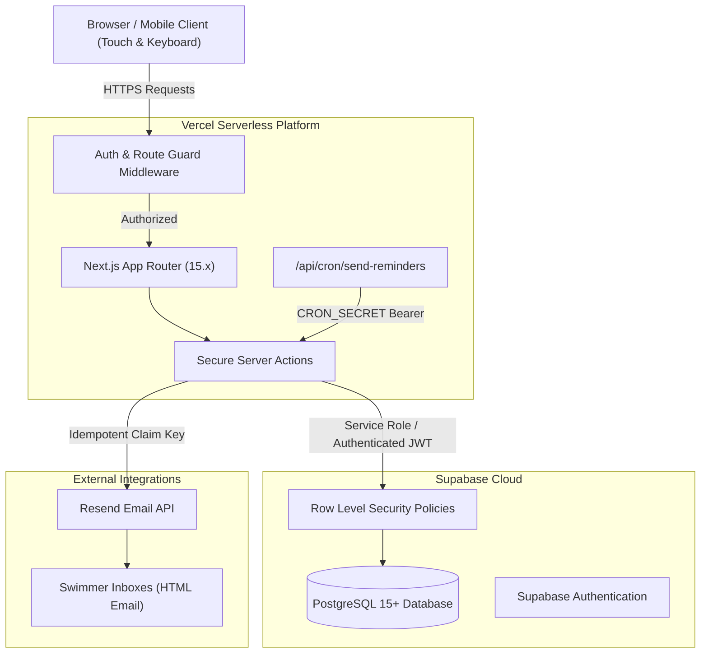

# SwimTrack Architecture Documentation

SwimTrack is engineered as a modern, single-tenant, open-source sports attendance engine. It is designed to run efficiently on Vercel Hobby with free-tier Postgres (Supabase) and email services (Resend).

## Key Architectural Principles

### 1. The Single-Administrator Model
Unlike standard multi-tenant SaaS products, SwimTrack assumes **one administrator**. Friends participating in squad practices do not create accounts or manage passwords. Only the administrator logs in via Supabase Auth, whose identity is checked against strict allowlisted environment variables (`ADMIN_USER_ID`, `ADMIN_EMAIL`).

### 2. Dual-Engine Data Store
To deliver zero-friction local onboarding:
- If Supabase environment variables are omitted or default to placeholders, SwimTrack boots in standalone **Local Demo Mode**, backed by a durable in-memory state initialized with realistic demonstration data.
- When Supabase credentials are configured, SwimTrack connects directly to PostgreSQL with Row Level Security.

### 3. Immediate Optimistic UI with Rollback
The Attendance Command Center uses client-side optimistic state updates for instantaneous responsiveness when marking attendance on pool deck, while guaranteeing that failed mutations immediately rollback with visual notification.

### 4. Recipient Consent & Idempotency
- Swimmers who have not explicitly enabled email reminders or who have opted out via their personal token are never contacted.
- Every email transmission derives an atomic claim key (`${sessionId}:${swimmerId}:${reminderType}:${date}`) passed to the `reminder_deliveries` table and Resend headers to prevent duplicate emails under concurrent cron triggers.
