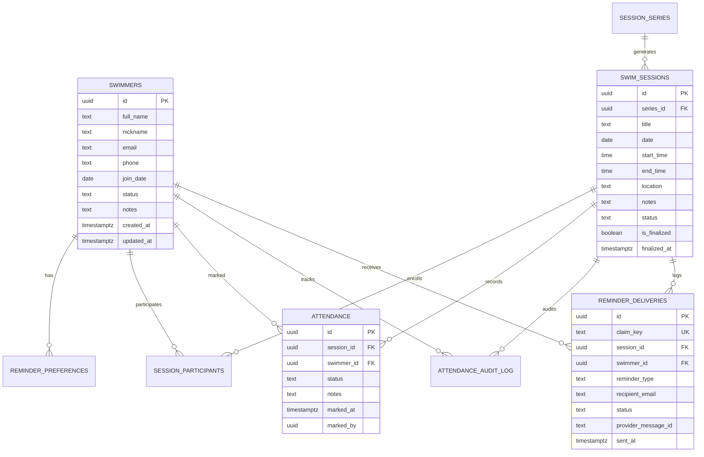

# Database Architecture & Schema

SwimTrack uses a normalized PostgreSQL schema optimized for Supabase with Row Level Security (RLS) enabled on all tables.

## Entity Relationship (ER) Diagram



## Migration Files

Schema migrations are located in `supabase/migrations/`:
- `20260101000000_swimtrack_schema.sql`: Complete DDL definitions, indexes, check constraints, foreign keys, and RLS policies.
- `supabase/seed.sql`: Demonstration seed data using fictional records.

## Applying Migrations

With the Supabase CLI installed:
```bash
# Reset local or remote database
supabase db reset
```

Or copy the SQL statements from `supabase/migrations/20260101000000_swimtrack_schema.sql` into the Supabase Dashboard SQL Editor.
