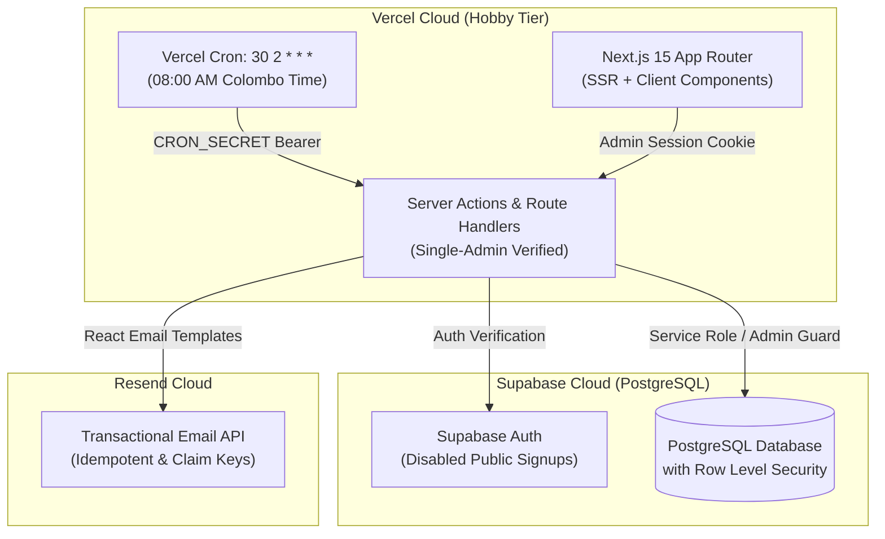

# Production Deployment Guide: Vercel, Supabase & Resend

SwimTrack V2 is architected to run **100% free** using standard developer free tiers with zero backend servers, Docker containers, or Redis instances:
- **Vercel** (Hobby Plan): Edge CDN, Next.js Serverless runtime, and Vercel Cron.
- **Supabase** (Free Tier): Managed PostgreSQL, Row Level Security (RLS), and Supabase Auth.
- **Resend** (Free Tier): 3,000 emails/month (100 emails/day) for session reminders.

---

## Architecture Overview



---

## Phase 1: Supabase Database & Auth Setup

### 1. Create a Supabase Project
1. Go to [database.new](https://database.new) and sign in to Supabase.
2. Click **New Project**:
   - **Name**: `swimtrack-prod` (or your choice).
   - **Database Password**: Generate and securely store a strong password.
   - **Region**: Select the region closest to Sri Lanka for minimal latency (e.g., **Singapore `ap-southeast-1`** or **Mumbai `ap-south-1`**).
   - **Pricing Plan**: Free Tier ($0/month).
3. Wait 1–2 minutes for the database cluster to provision.

### 2. Execute SQL Database Migrations
1. In the left sidebar of your Supabase dashboard, click **SQL Editor**.
2. Click **New query**.
3. Open [`supabase/migrations/20260101000000_swimtrack_schema.sql`](../supabase/migrations/20260101000000_swimtrack_schema.sql) from this repository, copy the full contents, and paste them into the SQL Editor.
4. Click **Run** (or press `Cmd + Enter`).
5. Verify output: All tables (`swimmers`, `swim_sessions`, `session_participants`, `attendance`, `reminder_preferences`, `reminder_deliveries`, `attendance_audit_log`, `app_settings`), indexes, functions, triggers, and RLS policies are created.

### 3. Create the Sole Administrator Account
1. In the left navigation, go to **Authentication > Users**.
2. Click **Add user** > **Create user**:
   - **Email**: Enter your personal administrator email (e.g., `admin@yourdomain.com`).
   - **Password**: Enter a secure admin password.
   - **Auto Confirm Email**: Checked / Enabled.
3. Click **Create user**.
4. In the users table, copy the newly created **User UID** (a UUID like `e7b92f44-8d4e-4b2a-89a1-7c98f8287d3a`). Save this for `ADMIN_USER_ID`.

### 4. Lock Down Supabase Authentication
1. Go to **Authentication > Providers > Email**.
2. **Disable "Allow new users to sign up"**: Uncheck this toggle so no public user can register an account. Only you (created via Dashboard) can sign in.
3. Click **Save**.

### 5. Collect Supabase Credentials
1. Go to **Project Settings > API**.
2. Copy the following keys:
   - **Project URL**: `https://<your-project-ref>.supabase.co`
   - **Project API Keys > `anon` `public`**: `eyJhbGciOi...`
   - **Project API Keys > `service_role` `secret`**: `eyJhbGciOi...` *(Keep this secret; it is used only server-side on Vercel)*.

---

## Phase 2: Resend Email Setup

### 1. Get an API Key
1. Go to [resend.com](https://resend.com) and create an account or sign in.
2. In the dashboard sidebar, click **API Keys**.
3. Click **Create API Key**:
   - **Name**: `SwimTrack Production`
   - **Permission**: `Full access`
4. Copy the generated key (`re_...`). This will be your `RESEND_API_KEY`.

### 2. Sender Domain Configuration
- **For immediate testing**: You can use Resend's default sandbox address:
  ```env
  RESEND_FROM_EMAIL="SwimTrack <onboarding@resend.dev>"
  ```
  *(Note: Resend's sandbox address can only deliver to the email address you signed up to Resend with).*
- **For sending to friends (Production Recommended)**:
  1. In Resend, go to **Domains > Add Domain** (e.g., `swimtrack.yourdomain.com` or `yourdomain.com`).
  2. Add the provided DNS records (SPF, DKIM, DMARC) in your domain registrar (Cloudflare, Namecheap, GoDaddy, etc.).
  3. Once verified (usually under 5 minutes), configure:
     ```env
     RESEND_FROM_EMAIL="SwimTrack <swimming@yourdomain.com>"
     ```

---

## Phase 3: Deploy to Vercel

### 1. Push to GitHub
Ensure all code is committed and pushed to your GitHub repository:
```bash
git push origin main
```

### 2. Import into Vercel
1. Go to [vercel.com](https://vercel.com) and sign in.
2. Click **Add New... > Project**.
3. Select your `SwimTrack` GitHub repository and click **Import**.

### 3. Configure Project Settings
- **Framework Preset**: `Next.js` (automatically detected).
- **Root Directory**: `./` (leave default).
- **Build Command**: `next build` (leave default).
- **Output Directory**: `.next` (leave default).

### 4. Set Environment Variables
In the **Environment Variables** section, add the following variables for the **Production** environment (you can also select Preview and Development):

| Variable Name | Example Value | Description |
|---|---|---|
| `NEXT_PUBLIC_APP_URL` | `https://swimtrack.vercel.app` | Production URL (without trailing slash) |
| `NEXT_PUBLIC_TIMEZONE` | `Asia/Colombo` | Timezone for Sri Lanka session timing |
| `NEXT_PUBLIC_SUPABASE_URL` | `https://xyzcompany.supabase.co` | Supabase Project URL |
| `NEXT_PUBLIC_SUPABASE_ANON_KEY` | `eyJhbGciOi...` | Supabase Anonymous Public Key |
| `SUPABASE_SERVICE_ROLE_KEY` | `eyJhbGciOi...` | Supabase Secret Service Role Key |
| `ADMIN_EMAIL` | `your-email@domain.com` | Verified administrator email allowlist |
| `ADMIN_USER_ID` | `e7b92f44-8d4e-4b2a-89a1-...` | Supabase Auth UID for your admin account |
| `RESEND_API_KEY` | `re_123456789_abcdefg` | Resend API key |
| `RESEND_FROM_EMAIL` | `SwimTrack <swimming@domain.com>` | Sender address with verified domain |
| `CRON_SECRET` | *(generate via command below)* | High-entropy token securing the cron endpoint |

> [!TIP]
> Generate a secure `CRON_SECRET` locally in your terminal using:
> ```bash
> openssl rand -base64 32
> ```

### 5. Deploy
1. Click **Deploy**.
2. Vercel will build the Next.js App Router application, bundle Server Actions, generate static routes, and deploy serverless functions.
3. Once deployed, note your production domain (e.g. `https://swimtrack-yourusername.vercel.app`).
4. If your production URL is different from what you entered in `NEXT_PUBLIC_APP_URL`, update `NEXT_PUBLIC_APP_URL` in **Project Settings > Environment Variables** and trigger a redeployment.

---

## Phase 4: Vercel Cron Verification

SwimTrack includes a pre-configured [`vercel.json`](../vercel.json):
```json
{
  "crons": [
    {
      "path": "/api/cron/send-reminders",
      "schedule": "30 2 * * *"
    }
  ]
}
```

### How the Cron Works:
- Schedule `30 2 * * *` fires daily at **02:30 UTC**, which corresponds exactly to **08:00 AM Asia/Colombo** (Sri Lanka Time, UTC+05:30).
- Vercel automatically sends an HTTP `GET` request to `/api/cron/send-reminders` with header:
  `Authorization: Bearer <CRON_SECRET>`
- The endpoint queries sessions scheduled for the current day and the upcoming day, checks each swimmer's reminder preferences, skips opted-out contacts, respects the 12-hour per-session cooldown, and delivers personalized emails via Resend.
- **Double Benefit**: Because the Vercel Cron queries Supabase daily, it also **prevents Supabase free-tier projects from pausing** due to inactivity!

### Testing the Cron Endpoint Manually:
You can trigger a manual cron execution from your terminal:
```bash
curl -X GET https://your-swimtrack.vercel.app/api/cron/send-reminders \
  -H "Authorization: Bearer YOUR_CRON_SECRET"
```
Expected response:
```json
{
  "success": true,
  "date": "2026-11-08",
  "sessionsScanned": 1,
  "remindersSent": 4,
  "skipped": 0,
  "errors": 0
}
```

---

## Phase 5: Post-Deployment Smoke Test Checklist

Follow this checklist immediately after your first deployment:

- [ ] **Public Landing Page (`/`)**: Open in an incognito window. The showcase landing page should display beautifully with zero private data or swimmer names exposed.
- [ ] **Admin Authentication (`/login`)**:
  - Attempt login with incorrect credentials: verify error message.
  - Sign in with your real admin email and password.
  - Verify redirect to `/dashboard`.
- [ ] **Sri Lanka Live Clock**: Verify the header/sidebar displays current Colombo time (`Asia/Colombo`).
- [ ] **Add Swimmers (`/swimmers`)**:
  - Add your friends to the roster with nicknames and optional emails.
  - Verify avatar generation and initials.
- [ ] **Create Session (`/sessions`)**:
  - Schedule a swimming session (e.g., Saturday 6:30 AM at CR&FC or SSC Pool).
  - Verify participant snapshot is created.
- [ ] **Mark Attendance (`/attendance`)**:
  - Mark attendance using quick action buttons (`P`, `A`, `L`, `E`).
  - Test keyboard shortcuts (`P`, `A`, `L`, `E`, `U`, `ArrowUp`, `ArrowDown`).
  - Click **Squad Recap** & verify the formatted WhatsApp message copies to your clipboard.
  - Finalize session: verify confetti and recap modal popup.
- [ ] **Review Analytics (`/analytics`)**:
  - View turnout trend charts, attendance rate breakdown, and the **Squad Persona & Polla Meter** rankings.
- [ ] **Settings & Backups (`/settings`)**:
  - Click **Export JSON Backup** and verify your attendance data downloads safely to your machine.

---

## Troubleshooting Guide

### 1. "Unauthorized: Admin privileges required"
- **Cause**: The `ADMIN_USER_ID` or `ADMIN_EMAIL` in Vercel environment variables does not exactly match the logged-in user in Supabase Auth.
- **Fix**: Open Supabase **Authentication > Users**, copy the exact `User UID` and email, paste into Vercel Environment Variables, and redeploy.

### 2. "Emails failing to send with Resend"
- **Cause**: Using an unverified domain with `RESEND_FROM_EMAIL` or sending to unverified emails while on Resend's sandbox mode (`onboarding@resend.dev`).
- **Fix**: If using `onboarding@resend.dev`, emails can only be delivered to your own Resend account email address. To send to friends, verify your custom domain in Resend under **Domains** and set `RESEND_FROM_EMAIL="SwimTrack <alerts@yourdomain.com>"`.

### 3. Vercel Build Errors
- **Fix**: Run `npm run typecheck`, `npm run lint`, and `npm test` locally. SwimTrack strictly adheres to TypeScript strict mode and Next.js 15 App Router conventions.
